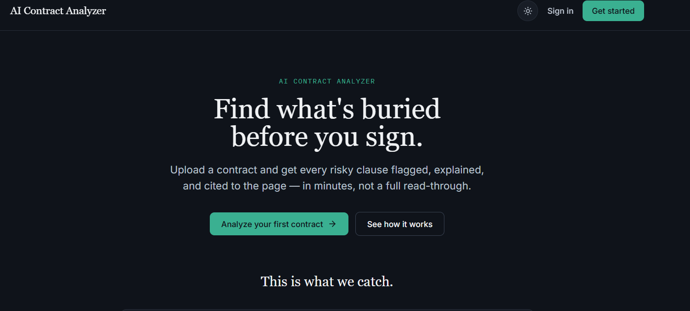
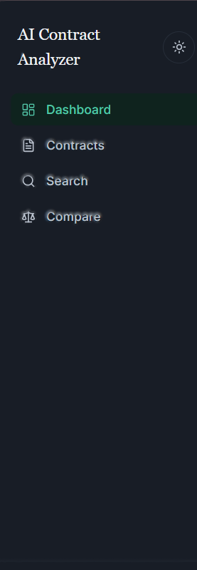
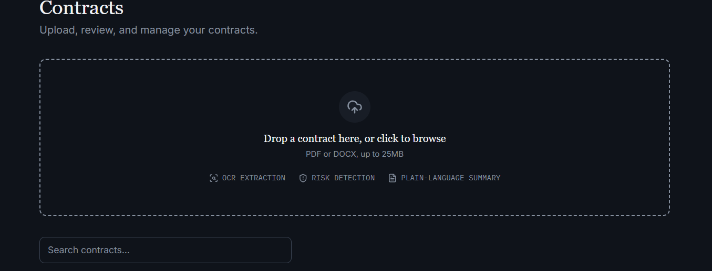

# 📄 AI Contract Analyzer — Understand Contracts in Minutes with AI

AI Contract Analyzer is a **production-ready full-stack platform** built for anyone who has to read, review, or sign a contract. It reads PDF/DOCX contracts, flags risky clauses with plain-English explanations, answers questions grounded in the contract's actual text with page citations, compares two contracts clause by clause, and exports everything as clean PDF reports.

The project demonstrates **modern software engineering practices**, including a service/repository-layered FastAPI backend, retrieval-augmented generation (RAG) with pgvector, JWT authentication with token rotation, and a fully typed React + TypeScript frontend.

---

# ✨ Features

## Authentication

- JWT Access & Refresh Tokens
- Refresh Token Rotation (old tokens invalidated on use)
- Secure Password Hashing (bcrypt)
- Change Password (revokes all other sessions)
- Protected Routes
- Per-User Data Isolation (every query scoped at the DB level)

---

## Document Management

- Upload PDF or DOCX contracts (up to 25MB)
- Automatic Text Extraction (PyMuPDF / python-docx)
- Scanned Page Detection + OCR Fallback (PaddleOCR)
- Search, Rename, and Delete Contracts
- Live Processing Status (uploaded → processing → processed / failed)

---

## AI Summaries

- One-Click Plain-English Summaries
- Covers Parties, Obligations, Payment Terms, and Duration
- Regenerate Anytime

---

## Risk Analysis

- Automatic Clause Categorization (Payment Terms, Termination, Notice Period, Auto-Renewal, Confidentiality, Non-Compete, Indemnification, Liability, Arbitration, Warranty, IP, Obligations)
- Severity Scoring (Low / Medium / High / Critical)
- Plain-English Explanation per Finding
- Suggested Fix per Finding
- Weighted Overall Risk Score (0–100)
- Re-Analysis Replaces Stale Findings (no duplicates)

---

## Chat With Your Contract (RAG)

- Natural-Language Q&A per Contract
- Answers Grounded Only in Retrieved Clauses (pgvector cosine search)
- Page-Level Citations on Every Answer
- Persistent Chat Sessions & Message History
- Refuses to Guess When the Contract Doesn't Address a Question

---

## Cross-Contract Search

- Semantic Search Across Every Contract You Own
- Ownership Enforced at the Query Level (JOIN-scoped, not filtered after the fact)

---

## Contract Comparison

- Side-by-Side Comparison of Two Contracts
- Added / Removed / Modified Clause Breakdown
- Changed Payment Terms, Notice Periods, and Obligations
- Rejects Comparing a Contract Against Itself

---

## Dashboard

- Total Contracts & Storage Used
- Risk Distribution (Low / Medium / High / Critical)
- Chat Sessions & Messages Sent
- Summaries Generated
- Comparisons Run
- Reports Generated
- Recent Contracts List

---

## Reports

- Summary Report (PDF)
- Risk Report (PDF)
- Clause Report, Grouped by Category (PDF)
- Comparison Report (PDF)
- Generated On the Fly — Nothing Stored on Disk

---

# 🛠 Technology Stack

## Frontend

- React 19 + TypeScript
- Vite
- Tailwind CSS
- shadcn/ui-style Components
- TanStack Query (React Query)
- Zustand
- React Hook Form + Zod
- Framer Motion
- Axios (with auto token-refresh interceptor)

---

## Backend

- FastAPI (Python 3.11)
- SQLAlchemy 2.0 + Alembic
- Pydantic v2
- python-jose (JWT)
- passlib + bcrypt
- Ollama + LangChain (`qwen2.5:7b-instruct`)
- sentence-transformers (`BAAI/bge-small-en-v1.5`)
- PyMuPDF + python-docx
- PaddleOCR
- ReportLab

---

## Database

- PostgreSQL 16 + **pgvector**, SQLAlchemy ORM

---

## Deployment

| Service | Platform |
|---------|----------|
| Frontend | Nginx (Docker, multi-stage build) |
| Backend | Uvicorn / Docker (multi-worker in prod) |
| Database | PostgreSQL + pgvector (Docker) |
| LLM Inference | Ollama (local or self-hosted) |
| CI | GitHub Actions |

---

# 📸 Screenshots

**Landing page**

**Create account**

**Dashboard navigation**

**Upload & manage contracts**

**Compare contracts**

---

# 👥 User Roles

| Role | Permissions |
|------|-------------|
| User | Upload/manage own contracts, generate summaries, run risk analysis, chat, compare, search, download reports |

Every endpoint enforces ownership at the database query level — a contract belonging to another user simply doesn't exist as far as any query is concerned (returns 404, not 403, so existence isn't leaked either).

---

# 🗄 Database Tables

- Users
- Refresh Tokens
- Contracts
- Document Chunks (with `vector(384)` embeddings)
- Contract Summaries
- Chat Sessions
- Chat Messages
- Risk Findings
- Contract Comparisons
- Generated Reports

---

# 🔒 Security Features

- JWT Authentication with Rotating Refresh Tokens
- Password Hashing (bcrypt)
- Ownership Checked at the Query Level on Every Route
- CORS Configuration
- File Type & Size Validation (extension + MIME type, never trusts the client filename for storage paths)
- Global Error Handler (no stack traces leaked to clients)
- Centralized Config Validation at Startup (fails fast on bad env vars)

---

# 📁 File Uploads

Supported uploads include:

- Contracts (PDF)
- Contracts (DOCX)

---

# 🚀 Future Enhancements

- Background Job Queue for Processing (Celery/Redis instead of synchronous `/process`)
- httpOnly Cookie-Based Token Storage
- Rate Limiting on Auth & AI Endpoints
- S3/GCS Object Storage for Uploads
- Streaming Chat Responses (SSE)
- Multi-Language Contract Support
- Clause-Level Redlining/Annotations in the UI
- Team/Organization Accounts with Shared Contract Access

---

# 🤝 Contributors

- **Your Name Here**

Feel free to contribute by opening issues or submitting pull requests.

---

# 📄 License

This project is licensed under the **MIT License** — see the [LICENSE](LICENSE) file for details.

---

# ⭐ Support

If you found this project helpful:

⭐ Star the repository

🍴 Fork the repository

🛠 Contribute to the project

---

## Made with ❤️ using FastAPI, React, PostgreSQL, pgvector & Ollama.