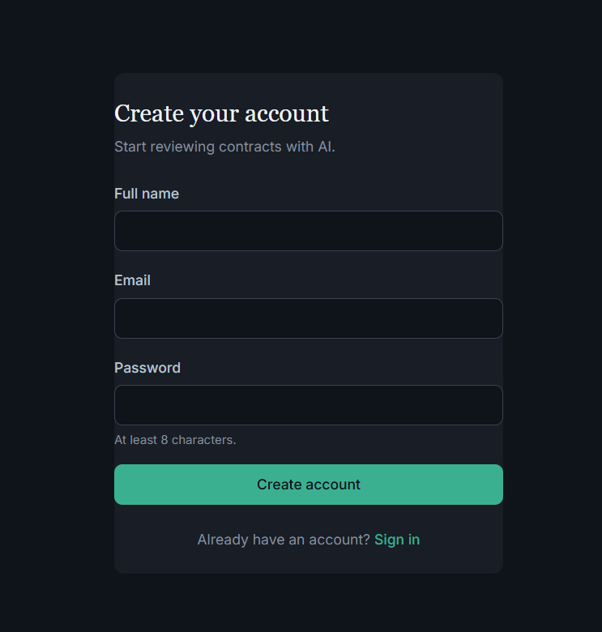
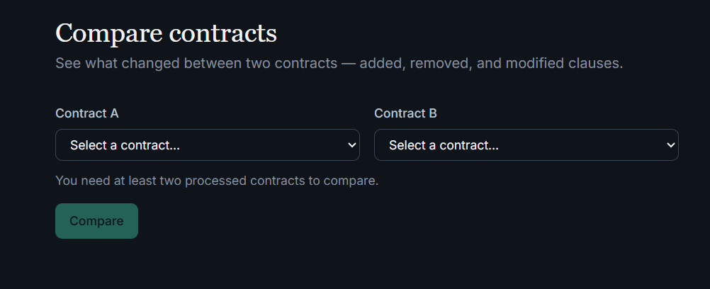

# 📄 AI Contract Analyzer — Understand Contracts in Minutes with AI

AI Contract Analyzer is a **full-stack AI-powered platform** built for anyone who has to read, review, or sign a contract. It reads PDF/DOCX contracts, flags risky clauses with plain-English explanations, answers questions grounded in the contract's actual text with page citations, compares two contracts clause by clause, and exports everything as clean PDF reports.

The project demonstrates **modern software engineering practices**, including a service/repository-layered FastAPI backend, retrieval-augmented generation (RAG) with pgvector, JWT authentication with token rotation, and a fully typed React + TypeScript frontend.

---

# ✨ Features

## Authentication

- JWT Access & Refresh Tokens
- Refresh Token Rotation (old tokens invalidated on use)
- Secure Password Hashing (bcrypt)
- Change Password (revokes all other sessions)
- Protected Routes
- Per-User Data Isolation (every query scoped at the DB level)

---

## Document Management

- Upload PDF or DOCX contracts (up to 25MB)
- Automatic Text Extraction (PyMuPDF / python-docx)
- Scanned Page Detection + OCR Fallback (PaddleOCR)
- Search, Rename, and Delete Contracts
- Live Processing Status (uploaded → processing → processed / failed)

---

## AI Summaries

- One-Click Plain-English Summaries
- Covers Parties, Obligations, Payment Terms, and Duration
- Regenerate Anytime

---

## Risk Analysis

- Automatic Clause Categorization (Payment Terms, Termination, Notice Period, Auto-Renewal, Confidentiality, Non-Compete, Indemnification, Liability, Arbitration, Warranty, IP, Obligations)
- Severity Scoring (Low / Medium / High / Critical)
- Plain-English Explanation per Finding
- Suggested Fix per Finding
- Weighted Overall Risk Score (0–100)
- Re-Analysis Replaces Stale Findings (no duplicates)

---

## Chat With Your Contract (RAG)

- Natural-Language Q&A per Contract
- Answers Grounded Only in Retrieved Clauses (pgvector cosine search)
- Page-Level Citations on Every Answer
- Persistent Chat Sessions & Message History
- Refuses to Guess When the Contract Doesn't Address a Question
- Streaming Responses (SSE)

---

## Cross-Contract Search

- Semantic Search Across Every Contract You Own
- Ownership Enforced at the Query Level (JOIN-scoped, not filtered after the fact)

---

## Contract Comparison

- Side-by-Side Comparison of Two Contracts
- Added / Removed / Modified Clause Breakdown
- Changed Payment Terms, Notice Periods, and Obligations
- Rejects Comparing a Contract Against Itself

---

## Dashboard

- Total Contracts & Storage Used
- Risk Distribution (Low / Medium / High / Critical)
- Chat Sessions & Messages Sent
- Summaries Generated
- Comparisons Run
- Reports Generated
- Recent Contracts List

---

## Reports

- Summary Report (PDF)
- Risk Report (PDF)
- Clause Report, Grouped by Category (PDF)
- Comparison Report (PDF)
- Generated On the Fly — Nothing Stored on Disk

---

# 🛠 Technology Stack

## Frontend

- React 19 + TypeScript
- Vite
- Tailwind CSS
- shadcn/ui-style Components
- TanStack Query (React Query)
- Zustand
- React Hook Form + Zod
- Framer Motion
- Axios (with auto token-refresh interceptor)

---

## Backend

- FastAPI (Python 3.11)
- SQLAlchemy 2.0 + Alembic
- Pydantic v2
- python-jose (JWT)
- passlib + bcrypt
- Ollama + LangChain (`qwen2.5:7b-instruct`)
- sentence-transformers (`BAAI/bge-small-en-v1.5`)
- PyMuPDF + python-docx
- PaddleOCR
- ReportLab

---

## Database

- PostgreSQL 16 + **pgvector**, SQLAlchemy ORM

---

## Deployment

| Service | Platform |
|---------|----------|
| Frontend | Nginx (Docker, multi-stage build) |
| Backend | Uvicorn / Docker (multi-worker in prod) |
| Database | PostgreSQL + pgvector (Docker) |
| LLM Inference | Ollama (local or self-hosted) |
| CI | GitHub Actions |

---

# 📸 Screenshots

**Landing page**


**Create account**



**Dashboard navigation**


**Upload & manage contracts**


**Compare contracts**


---

# 👥 User Roles

| Role | Permissions |
|------|-------------|
| User | Upload/manage own contracts, generate summaries, run risk analysis, chat, compare, search, download reports |

Every endpoint enforces ownership at the database query level — a contract belonging to another user simply doesn't exist as far as any query is concerned (returns 404, not 403, so existence isn't leaked either).

---

# 🗄 Database Tables

- Users
- Refresh Tokens
- Contracts
- Document Chunks (with `vector(384)` embeddings)
- Contract Summaries
- Chat Sessions
- Chat Messages
- Risk Findings
- Contract Comparisons
- Generated Reports

---

# 🔒 Security Features

- JWT Authentication with Rotating Refresh Tokens
- Password Hashing (bcrypt)
- Ownership Checked at the Query Level on Every Route
- CORS Configuration
- File Type & Size Validation (extension + MIME type, never trusts the client filename for storage paths)
- Global Error Handler (no stack traces leaked to clients)
- Centralized Config Validation at Startup (fails fast on bad env vars)

---

# 📁 File Uploads

Supported uploads include:

- Contracts (PDF)
- Contracts (DOCX)

---

# 🚀 Future Enhancements

- Background Job Queue for Processing (Celery/Redis instead of synchronous `/process`)
- httpOnly Cookie-Based Token Storage
- Rate Limiting on Auth & AI Endpoints
- S3/GCS Object Storage for Uploads
- Multi-Language Contract Support
- Clause-Level Redlining/Annotations in the UI
- Team/Organization Accounts with Shared Contract Access

---

# 🤝 Contributors

- **Yash Agrawal** — [GitHub](https://github.com/Yash-2422)

Feel free to contribute by opening issues or submitting pull requests.

---

# 🚀 Getting Started

## Prerequisites

- [Docker](https://www.docker.com/) and Docker Compose (recommended)
- For local development without Docker: Python 3.11, Node.js 22, PostgreSQL 16 with the `pgvector` extension, and [Ollama](https://ollama.com/)

## Clone the repository

```bash
git clone https://github.com/Yash-2422/AI-Contract-Analyzer.git
cd AI-Contract-Analyzer
```

## Run with Docker (recommended)

**Windows (PowerShell):**

```powershell
Copy-Item backend\env.example backend\.env
docker compose up --build
```

**macOS / Linux:**

```bash
cp backend/env.example backend/.env
docker compose up --build
```

- Frontend: [http://localhost:5173](http://localhost:5173)
- API: [http://localhost:8000](http://localhost:8000)
- Swagger docs: [http://localhost:8000/api/docs](http://localhost:8000/api/docs)

## Ollama

Ollama runs on the host machine, not inside Docker. Pull the model this project uses and start the server before using any AI features:

```bash
ollama pull qwen2.5:7b-instruct
ollama serve
```

## Environment configuration

`backend/env.example` provides a starting point for the environment configuration. Additional settings and their defaults are defined in `app/core/config.py`.

## Local development

**Backend:**

```bash
cd backend
python -m venv venv
```

Activate the virtual environment:

```powershell
# Windows PowerShell
venv\Scripts\Activate.ps1
```

```bash
# macOS / Linux
source venv/bin/activate
```

Then:

```powershell
# Windows PowerShell
pip install -r requirements-local.txt
Copy-Item env.example .env
alembic upgrade head
uvicorn app.main:app --reload
```

```bash
# macOS / Linux
pip install -r requirements-local.txt
cp env.example .env
alembic upgrade head
uvicorn app.main:app --reload
```

**Frontend:**

```bash
cd frontend
npm install
npm run dev
```

The frontend dev server proxies `/api` requests to `http://localhost:8000`.

## Production deployment

```bash
docker compose --env-file .env -f docker-compose.yml -f docker-compose.prod.yml up -d db
docker compose --profile migration --env-file .env -f docker-compose.yml -f docker-compose.prod.yml run --rm migrate
docker compose --env-file .env -f docker-compose.yml -f docker-compose.prod.yml up -d --build backend frontend
```

The backend connects as `POSTGRES_APP_USER` (default `contract_app`) using
`POSTGRES_APP_PASSWORD`. Keep the database administrator credentials in
`POSTGRES_USER` and `POSTGRES_PASSWORD`; the API container receives only the
application connection URL. Use a strong URL-safe application password when
Compose builds the internal PostgreSQL URL. Do not set the application role to
the administrator role.

The one-shot `migrate` service runs as the database administrator/migration
owner. It creates the application role if absent, rejects an existing role with
elevated attributes or role memberships, sets default table/sequence grants,
runs Alembic, grants DML on application tables and sequence access, and removes
application access to `alembic_version`. It does not rely on
`docker-entrypoint-initdb.d`, so it can provision grants on an existing volume
without recreating the volume or touching user records. Run it before starting
or restarting the API after changing the runtime database role. The existing
`DATABASE_URL` used by Alembic is supplied only to the migration container.

Verify the running API's role without printing its connection URL:

```bash
docker compose --env-file .env -f docker-compose.yml -f docker-compose.prod.yml exec backend python scripts/verify_application_role.py
```

For managed PostgreSQL, create the application role using the provider's SQL
console or role-management UI, then configure `APP_DATABASE_URL` with that
role's connection string and `MIGRATION_DATABASE_URL` with the database owner
or migration administrator connection string. URL-encode credentials and
require TLS where the provider supports it. The migration role must be able to
run the existing Alembic migrations, grant table/sequence privileges, and use
the `vector` extension. A managed database that does not permit role creation
must have the application role provisioned manually before migrations.
Use `docker-compose.managed-db.yml` as the third Compose file so the local
PostgreSQL service is not started:

```bash
docker compose --profile migration --env-file .env -f docker-compose.yml -f docker-compose.prod.yml -f docker-compose.managed-db.yml run --rm migrate
docker compose --env-file .env -f docker-compose.yml -f docker-compose.prod.yml -f docker-compose.managed-db.yml up -d --build backend frontend
```

Set `POSTGRES_APP_USER` and `POSTGRES_APP_PASSWORD` in the migration job's
secret environment as well. If the provider will not allow the migration role
to create roles, create the application role first with the attributes below;
the migration job verifies its attributes and applies the object grants.

Example least-privilege role setup (replace identifiers/password in the
provider console; do not put the literal example password into deployment):

```sql
CREATE ROLE contract_app LOGIN PASSWORD 'replace-with-a-strong-url-safe-secret'
    NOSUPERUSER NOCREATEDB NOCREATEROLE NOREPLICATION NOBYPASSRLS NOINHERIT;
GRANT CONNECT ON DATABASE contract_analyzer TO contract_app;
GRANT USAGE ON SCHEMA public TO contract_app;
ALTER DEFAULT PRIVILEGES FOR ROLE migration_owner IN SCHEMA public
    GRANT SELECT, INSERT, UPDATE, DELETE ON TABLES TO contract_app;
ALTER DEFAULT PRIVILEGES FOR ROLE migration_owner IN SCHEMA public
    GRANT USAGE, SELECT, UPDATE ON SEQUENCES TO contract_app;
```

Replace `migration_owner` with the role that runs Alembic. Run migrations as
that owner so its default privileges apply to future application tables. The
migration job grants access to existing application tables, sequences, and
the pgvector type after applying migrations; it deliberately withholds access
to `alembic_version`.

The production Compose file reads `POSTGRES_PASSWORD`, `JWT_SECRET_KEY`, and
`GEMINI_API_KEY` from the project-root `.env` file. The frontend and API use a
same-origin Nginx proxy by default, so `ALLOWED_ORIGINS` may be left empty. If
the frontend is hosted on a separate domain, set `ALLOWED_ORIGINS` to a
comma-separated list of exact browser origins, including the scheme and any
non-default port, for example:

```dotenv
ALLOWED_ORIGINS=https://contracts.example.com,https://admin.example.com
```

Do not include URL paths or use `*` when credentialed browser requests are
enabled. Production authentication cookies are marked `Secure`; serve the
application over HTTPS. Local development keeps cookies compatible with HTTP.
The current `SameSite=Lax` cookie policy is intended for same-site deployments;
a frontend on a separate site may need a coordinated cookie and CSRF design in
addition to this CORS allowlist. Prefer the same-origin Nginx proxy when possible.

---

# 📄 License

License information will be added before the first public release.

---

# ⭐ Support

If you found this project helpful:

⭐ Star the repository

🍴 Fork the repository

🛠 Contribute to the project

---

## Made with ❤️ using FastAPI, React, PostgreSQL, pgvector & Ollama.
